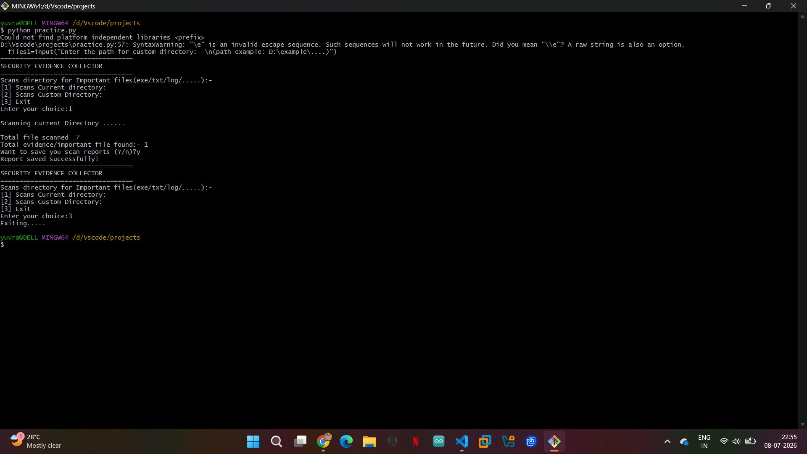

# Security Evidence Collector

**A shallow file-metadata inventory exercise for DFIR learning.**

This Python CLI lists files with selected extensions in the current or a chosen
directory, displays name/size/path, and can save a text report. It does not
acquire forensic images, prove evidence integrity or implement chain of custody.

## Run

Python 3 and its standard library are sufficient.

```sh
git clone https://github.com/Yuvraj-26-k/security-evidence-collector.git
cd security-evidence-collector
python security.py
```

Choose `1` for the current directory or `2` for a custom path. Start with a
disposable folder of synthetic `.txt`/`.log` files. Choose a unique output
filename such as `inventory-demo.txt`; existing files can be overwritten.

## What it collects

Supported, case-sensitive suffixes are `.txt`, `.log`, `.pdf`, `.docx`, `.exe`,
`.bat` and `.ps1`. Collection is non-recursive and reports metadata only. The
program changes its working directory for custom scans; relative output paths
follow that selected directory.

## Limitations

There is no hashing, content analysis, provenance record or integrity guarantee.
Regular-file and permission handling need improvement. Reports can contain ANSI
color codes and absolute machine paths. Do not use valuable source/evidence
folders for experiments or publish reports containing private paths/data.



The existing screenshot shows an earlier interface run and is not proof of a
validated forensic workflow. The repository contains `security.py`, this guide
and that screenshot. No first-party tests are tracked.

Next priorities are reusable functions, regular-file checks, robust errors,
create-only structured output and synthetic tests. Source/history remain in
this repository; no consolidation is performed by the documentation update.
